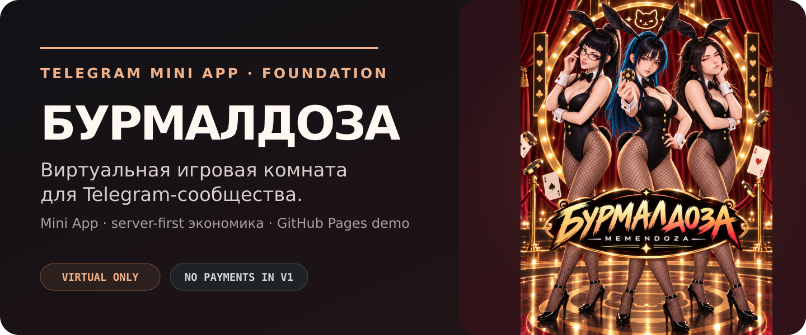

<p align="center">
  <picture>
    <source media="(max-width: 700px)" srcset="./assets/readme/hero-mobile.png">
    
  </picture>
</p>

# Бурмалдоза

Игровой слой для Telegram-сообщества Memendoza: бот — точка входа, Mini App — игровой лаунж, FastAPI — источник подтверждённого состояния.

[Открыть Pages-пилот](https://hainox.github.io/BURMALDOZA/) · [Локальный запуск](./docs/Local-Setup.md) · [BuildSpec](./dev/BuildSpec.md) · [Slot v2](./docs/Slot-V2-Status.md) · [CCode workflow](./docs/Command-Code-Workflow.md) · [Архитектура](./docs/Technical-Architecture.md)

> В репозитории есть два режима: Pages-demo с безопасным demo-fallback и server-first режим для Telegram Mini App. Если `PUBLIC_API_BASE_URL` или Telegram `initData` отсутствуют, клиент остаётся в демо-контуре; платежи и реальные деньги не подключены.

## Что собрано

| Часть | Сейчас | Граница |
|---|---|---|
| Domain | 3×7 Slot, Blackjack GFL, heads-up Hold’em / RGG Poker | чистые правила, CSPRNG adapter, seeded Monte Carlo вне request path |
| Economy | Jokergem (`JOKERGEM`), welcome/daily/relief baseline | целые единицы, append-only ledger, no cash value |
| API | FastAPI auth, wallet и история операций, rooms, snapshots/events, reconnect | raw Telegram `initData`, idempotency, state version |
| Bot | aiogram `/start`, `/casino`, `/balance`, `/top`, `/help` | ответы по явной команде, API-backed balance/top |
| Mini App | SvelteKit shell, три room views, история операций кошелька, safe areas, reduced motion, live API client | UI получает подтверждённый server event; без API работает DEMO fallback |
| Runtime | Dockerfile API/bot/Mini App, Compose, CI | PostgreSQL 16, Redis 7, health checks |

## Игровые комнаты

У каждой комнаты своя вселенная (решение владельца, 13.10.2026):

| Комната | Тема | Что в `main` | В работе |
|---|---|---|---|
| **Blackjack** | Girls' Frontline: колоды Deck A/B с персонажами, сцена Sector 09 | Hit / Stand / Double, закрытая карта дилера, DEMO-стол, resync после 409 | — |
| **Slot 3×7** | Rainbow Six Siege: символы-оперативники, «операции» с недельной ротацией лиц | правила `slot-skeleton-1`, три линии, staged stop | правила `slot-siege-1` (8 символов, RTP ≈ 96 %) — PR #70; дизайн — PR #63 |
| **Hold’em** | игры RGG (Yakuza / Judgment): Камуро-тё, герои-соперники по столам | доменные правила heads-up, DEMO-комната | серверная игра против бота и живого игрока, столы 100 / 500 / 1 000 — PR #71; дизайн — PR #63 |

Портреты персонажей используются в некоммерческом фанатском превью с атрибуцией источников (`sources.json` рядом с ассетами).

У всех комнат одна state-driven последовательность: `intent → accepted → resolving → confirmed outcome → settle`. Анимация не генерирует исход; она объясняет уже подтверждённое событие. При reduced motion промежуточные эффекты схлопываются, но legal actions и result explanation остаются.

Slot v2 дополнительно требует полной вертикальной прокрутки барабанов, разгона, инерционного торможения, последовательной остановки слева направо и payout highlight. Free Spins («Овертайм») в движке слота пока нет — владелец отложил их 13.10.2026. Бонусная мини-игра остаётся временной заглушкой.

## Jokergem v0.1

Название provisional и может быть заменено без миграции целочисленных балансов.

- welcome: `1 000` один раз;
- daily: `250` раз в 24 часа;
- relief: `300` при балансе ниже `50`, не чаще раза в 72 часа;
- нет покупки, вывода, обмена, Stars, призов и реальных денег.

Это техническая baseline-конфигурация для закрытого теста, а не обещание дохода и не решение о монетизации.

## Разработка

```bash
cp .env.example .env
pnpm install --frozen-lockfile
uv sync --locked --all-groups
pnpm --dir apps/miniapp exec playwright install chromium
```

Полная Compose-инструкция и правила секретов: [docs/Local-Setup.md](./docs/Local-Setup.md).

Для live-режима нужен публичный HTTPS API endpoint. Локальный build с API:

```bash
PUBLIC_API_BASE_URL=http://localhost:8000 pnpm --dir apps/miniapp build
```

Для GitHub Pages задайте repository/environment variable `PUBLIC_API_BASE_URL`; Pages workflow передаст её в build. Если переменная пустая, опубликованный URL намеренно остаётся визуальным DEMO.

Основные проверки:

```bash
uv run --locked ruff check .
uv run --locked pytest -q
pnpm miniapp:check
pnpm miniapp:test
pnpm miniapp:build
pnpm miniapp:e2e
```

Monte Carlo evidence:

```bash
python -m devtools.monte_carlo.slot --trials 100000 --bet 10 --seed 42 --json
python -m devtools.monte_carlo.blackjack --trials 100000 --bet 25 --seed 42 --json
python -m devtools.monte_carlo.holdem --trials 100000 --seed 42 --json
```

CI повторяет Python lint/tests, Mini App check/test/build, PostgreSQL/Redis services и сохраняет три JSON-отчёта как artifact.

## Проверенное состояние `main` (`141729d`, 13.10.2026)

Источник истины — CI на каждом PR и на `main` (Python lint/tests с PostgreSQL 16 и Redis 7, Mini App check/test/build, E2E, Docker Compose build). Локальный прогон на чистой копии:

- `uv run --locked ruff check .`: clean.
- `uv run --locked pytest -q` с PostgreSQL 16 и Redis 7 в Docker: 149 passed, интеграционные выполнены.
- `pnpm miniapp:check`: 0 errors / 0 warnings.
- `pnpm miniapp:test`: 27 passed.
- `pnpm miniapp:build`: passed.
- `pnpm miniapp:e2e`: 30 passed, 1 failed — известный нестабильный тест остановки барабанов `slot-stop.spec.ts`, иногда падает по таймингу при параллельном прогоне.
- Локальный `.env` с другим `MINIAPP_URL` меняет результат `tests/unit/test_cors.py`; проверяйте на чистой копии или в CI.

## Документы

- [AGENTS.md](./AGENTS.md) — общие правила для ИИ-агентов: роли, ветки, merge, штаб, формат отчёта.
- [BuildSpec](./dev/BuildSpec.md) — комнаты, экономика, Hold’em v1, границы и критерии приёмки.
- [Роадмап](./docs/Development-Roadmap.md) — foundation → tests → QA → thematic content.
- [Техническая архитектура](./docs/Technical-Architecture.md) — границы модулей и финальный стек.
- [Design concept](./docs/Design-Concept.md) — native UI, motion system и темы комнат.
- [Чекпоинт запуска](./docs/Launch-Checkpoint.md) — что готово, открытые блокеры и условия запуска.
- [Чеклист ручной приёмки](./docs/Manual-QA-Checklist.md) — проверка на iOS, Android и Telegram Desktop.
- [Production deploy](./docs/Deploy-Production.md) — сервер, `.env`, проверки, резервные копии и откат.
- [Slot v2 status](./docs/Slot-V2-Status.md) — полный цикл барабанов, Free Spins и тестовая матрица.
- [Codex ↔ Command Code workflow](./docs/Command-Code-Workflow.md) — модели, effort и handoff-шаблон.
- [Project log](./dev/ProjectLog.md) — решения и evidence.
- [Журнал проекта](./docs/project-journal/README.md) — локальная страница со статусом задач и PR (сайт штаба).

Лицензия пока не выбрана; файл `LICENSE` отсутствует.
